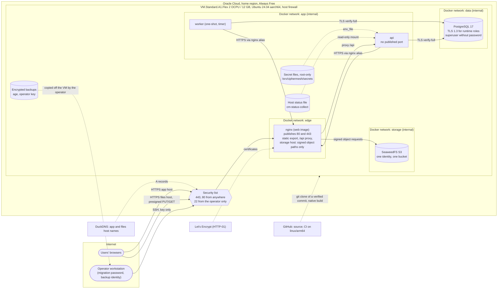

# Deployment Architecture

Status: decided in [ADR-014](../architecture/adr/ADR-014-cloud-provider-oci-always-free.md) (2026-10-14): one Oracle Cloud Infrastructure Always Free VM (Ampere A1, aarch64) running every server-side component in containers. Implemented and rehearsed in the repository (`infrastructure/`); the cloud resources are created only after the account owner approves the plan in [oracle-always-free.md](../deployment/oracle-always-free.md). Related: [service-models.md](service-models.md), [shared-responsibility.md](shared-responsibility.md), [cloud-security-hardening.md](../deployment/cloud-security-hardening.md), [../architecture/trust-boundaries.md](../architecture/trust-boundaries.md).

## 1. Topology

The ops container (role bootstrap and migrations) is started only by the operator, joins the PostgreSQL container's network namespace and reaches it on that namespace's loopback, so no database port exists anywhere.

## 2. Network exposure

| Endpoint | Exposed to | Port | Notes |
|---|---|---|---|
| Nginx HTTPS, application host | Internet | 443 | TLS 1.2 and 1.3 (CP-21); unknown host names get no TLS handshake |
| Nginx HTTPS, storage host | Internet | 443 | Only signed requests for `/<bucket>/f/<key>`; cookies refused; listing, other buckets and every SeaweedFS endpoint refused |
| Nginx HTTP | Internet | 80 | Redirect to HTTPS and ACME challenges only |
| SSH | The operator's address (security list) | 22 | Key authentication only, no root, AllowUsers |
| API | Nginx only, internal app network | none published | |
| Worker | No inbound | none | One-shot container started by a timer |
| PostgreSQL | API and worker on the internal data network; the ops container on its loopback | none published | `hostssl` with SCRAM for runtime roles; superuser by peer only |
| SeaweedFS (S3, master, volume, filer) | Nginx on the internal storage network | none published | IAM API off; one identity limited to the content bucket |
| Docker socket | Nobody | not applicable | Root-only, never mounted into a container |

**Docker and the host firewall:** Docker inserts its own packet-filter rules for published ports, which bypass INPUT rules. Controls: the security list is the primary filter; only Nginx publishes ports; the `DOCKER-USER` chain drops forwarded traffic from outside to anything but ports 80 and 443 (`cm-firewall docker-user`, re-applied at every Docker start).

## 3. Containers

| Service | Image | Security settings |
|---|---|---|
| nginx | `ciphermesh-web` (unprivileged Nginx 1.30 Alpine, digest-pinned, with the static export and the generated headers) | uid 101, read-only root filesystem, tmpfs `/tmp`, `cap_drop: ALL`, `no-new-privileges`, 256 MB |
| api | `ciphermesh-api` (Node.js 24 Alpine, production dependencies only) | uid 1000, read-only, tmpfs `/tmp`, no capabilities, 768 MB, health check |
| worker | `ciphermesh-api`, `dist/worker-retention.js` | As api; profile `jobs`, started every 15 minutes by `ciphermesh-worker.timer` |
| postgres | `postgres:17.11-alpine3.24` (digest-pinned) | Read-only root, the data volume, TLS material from a volume; the five capabilities the entrypoint needs to switch to uid 70; 1.5 GB |
| object-storage | `chrislusf/seaweedfs:4.47` (digest-pinned) | Runs as uid 1000 directly, read-only root, no capabilities, 768 MB |
| ops | `ciphermesh-ops` (build stage with the Prisma CLI and `scripts/db`) | Operator-run only; read-only, no capabilities, PostgreSQL's network namespace |

Rules for all containers: base images pinned by digest, no `privileged`, no host network, no Docker socket, log rotation (10 MB, 5 files), restart `unless-stopped`.

## 4. Nginx responsibilities

- TLS termination with Let's Encrypt certificates (ECDSA P-256), renewed by the host's certbot timer, installed for uid 101 by `cm-tls install` (CP-21).
- HTTP to HTTPS redirect; HSTS staged with `CM_HSTS_MAX_AGE` (0, then 86400 after the renewal dry run).
- Serves the static export with the generated CSP and headers; content-hashed assets cached for a year, HTML `no-cache`; dotfiles and source maps refused; only GET and HEAD for pages.
- Proxies `/api/` to the API with the spoofable forwarding headers replaced (TRUST_PROXY_HOPS=1).
- Rate limits: authentication entry points 10 per minute per address, directory lookup 30 per minute, the API 20 per second, storage 10 per second; connection limits; request body 128 KiB for the API and 51 MiB for storage.
- Access log as JSON with the path only (no query strings, which carry presigned signatures), no bodies.

Security headers set by Nginx come from the web build (`apps/web/out-meta/security-headers.json`, rendered by `infrastructure/nginx/render-security-headers.mjs`):

| Header | Value (baseline) |
|---|---|
| Content-Security-Policy | `default-src 'none'; script-src 'self' 'wasm-unsafe-eval' <build hashes>; style-src 'self'; img-src 'self' blob:; font-src 'self'; connect-src 'self' https://<storage host>; manifest-src 'self'; form-action 'none'; frame-ancestors 'none'; base-uri 'none'; object-src 'none'` |
| Strict-Transport-Security | `max-age=<CM_HSTS_MAX_AGE>`; no `includeSubDomains` (the parent zone is DuckDNS's), no preload |
| X-Content-Type-Options | `nosniff` |
| Referrer-Policy | `no-referrer` |
| Permissions-Policy | Deny camera, microphone, geolocation, payment, USB and similar features |
| Cross-Origin-Opener-Policy | `same-origin` |
| Cross-Origin-Resource-Policy | `same-origin` |
| X-Frame-Options | `DENY` (legacy browsers; `frame-ancestors` is authoritative) |
| Cache-Control (API responses) | `no-store` (set by the API) |
| Access-Control-Allow-Origin | Never sent by the application. Storage answers CORS for the application origin only |

## 5. Secrets and credentials

| Secret | Consumer | Storage |
|---|---|---|
| Database URLs of `cm_api` and `cm_worker` (with their passwords) | api, worker | `/srv/ciphermesh/secrets/{api,worker}_database_url`, uid 10001, 0400, generated on the VM by `cm-secrets`, mounted at `/run/secrets` |
| Storage runtime key | api, worker, SeaweedFS | `storage_secret_access_key` (uid 10001, 0400) and `seaweedfs-identities.json` (uid 1000, 0400); the access key ID (not secret) in `api.env` and `worker.env` |
| TOTP_ENCRYPTION_KEY, IDENTIFIER_HMAC_KEY | api | `totp_encryption_key`, `identifier_hmac_key` (uid 10001, 0400); 32 random bytes each; the API refuses to start if either is missing, malformed or equal (Phase 3); the TOTP key ID is in `api.env` |
| PostgreSQL superuser | nobody over the network | No password; peer authentication on the container socket only (ADR-014) |
| Migration role (`cm_migrator`) password | operator, during `cm-db-init` and `cm-migrate` | Operator's workstation only; piped over SSH for one run |
| Database server key | PostgreSQL | Volume `ciphermesh-postgres-tls`, uid 70, 0600; the CA key is deleted after signing (CD-34) |
| TLS private keys | nginx | `/etc/ciphermesh/tls/{app,files}/privkey.pem`, uid 101, 0600; originals in `/etc/letsencrypt` (root) |
| Backup identity (age private key) | operator | Offline on the operator's workstation; the VM holds only the recipient (CD-35) |
| Audit signing key | (none yet) | Phase 12 is deferred; no key exists |

Secrets never appear in the repository, images, CI logs, Jira or evidence. The API and the worker read them as files under `/run/secrets` (`<NAME>_FILE`), so they never appear in a container's environment or in `docker inspect`; root and Docker access can still read the files (L-75).

## 6. Data services configuration

- **PostgreSQL:** `infrastructure/postgres/postgresql.conf` and `pg_hba.conf`: TLS 1.3 only for runtime roles from the data network, SCRAM-SHA-256, everything without TLS refused, the superuser by peer only; 70 connections; statement logging off; UTC. The roles, grants and migrations are the reviewed ones of Phase 2 onwards (`scripts/db/bootstrap.mjs`, `prisma/migrations`).
- **Content storage:** SeaweedFS with one identity (`Read` and `Write` on the content bucket only), the IAM API off, CORS for the application origin, signatures verified for the public storage origin. The bucket is created inside the container with `weed shell` (`cm-storage-init`), so no administrator credential exists. No versioning or lifecycle rules (L-74).
- **Anchor bucket:** none (Phase 12 deferred; ADR-014).

## 7. Operations

- **Patching:** unattended security upgrades for the OS; images rebuilt from digest-pinned bases by `cm-deploy`; reboot procedure in [operational-runbook.md](../deployment/operational-runbook.md).
- **Time:** NTP synchronization (systemd-timesyncd), UTC.
- **Logging:** Docker JSON logs with rotation; Nginx JSON access log without query strings; the application's redacted logs.
- **Monitoring:** container health checks; `cm-status-collect` every 5 minutes (instance metadata, container health, disk, memory, certificates, firewall, job outcomes) read by the API for the platform dashboard with freshness limits; the external edge checker at every deployment.
- **Backups:** `cm-backup` daily at 03:30 UTC, encrypted with age; restore drill and full restore documented in [backup-and-restore.md](../deployment/backup-and-restore.md).

## 8. Build and deployment

1. A pull request runs CI: lint, typecheck, all tests, scans, SBOM, E2E in three engines, and the cloud stack on linux/arm64 (native image build, rehearsal stack, edge checks, deployment smoke test, backup, restore drill, full restore).
2. The operator runs `cm-deploy <commit>` on the VM: the commit must be on a branch of the origin; Git verifies the objects; the images are built natively and tagged with the commit; a release with pending migrations is not started until `cm-backup` and `cm-migrate` ran.
3. After deployment: the smoke check of `cm-deploy`, the edge checker from outside, and the deployment smoke test in three engines.
4. Rollback: `cm-deploy --rollback` switches to the previous release's images (migrations are forward-only; their rollback is a restore).

## 9. Environments

| Environment | Purpose | Data |
|---|---|---|
| Local development | `infrastructure/docker/compose.dev.yml`: PostgreSQL and SeaweedFS bound to 127.0.0.1 | Synthetic only |
| Local rehearsal and CI | `cm-rehearsal`: the cloud stack on loopback with a throwaway CA; CI runs it on linux/arm64 | Synthetic only |
| Cloud demonstration | The Oracle VM | Synthetic demonstration data only; no real personal data |

Credentials of one environment are never used in another (ISO/IEC 27001:2022 controls 8.31 and 8.33).

## 10. VM hardening baseline

The checklist and its verification evidence are in [cloud-security-hardening.md](../deployment/cloud-security-hardening.md) section 3.
