# Authorization Model

Status: Phase 0.5 baseline. Normative. The central module and the shared matrix are implemented since Phase 5 (CM-T029); section 9 records how. Phase 6 added AZ-31 and the invitation and room-key routes (section 9.7). Phase 9 added AZ-32 and the secret routes (section 9.10). Related: [security-policy-profiles.md](security-policy-profiles.md), [../architecture/data-model.md](../architecture/data-model.md), [../threat-model/threat-model.md](../threat-model/threat-model.md) (T-05, T-06).

## 1. Principles

1. **Deny by default.** Every route requires an authenticated session unless it is on the explicit public allowlist (registration, login, MFA verification during login, health and readiness checks). In code this is `PUBLIC_ROUTE_ALLOWLIST` in `apps/api/src/routes/system.ts`, enforced by the route registry.
2. **Server-side only.** Hiding a button is not authorization. The API decides every privileged action.
3. **Database-loaded state.** Roles, membership, ownership and profile are read from the database on every request. Nothing in the request body or cookie grants privileges.
4. **Object-level checks.** Every object is loaded through its room and checked against the caller's membership, which is the main defence against BOLA/IDOR.
5. **Least privilege.** Roles get only the actions they need. The platform administrator has no implicit access to rooms.
6. **Two layers.** Even if an authorization check fails open, room content stays encrypted and envelopes are useful only to their recipient. Cryptography is the second layer, never the only one.

## 2. Roles

### 2.1 Room roles

| Role | Purpose | Constraints |
|---|---|---|
| OWNER | Accountable for the room: profile, deletion, ownership, approvals | Exactly one ACTIVE OWNER per room. Cannot leave before transferring ownership |
| ADMIN | Day-to-day administration: invitations, member management, key rotation | Cannot create ADMINs, cannot remove or demote the OWNER or other ADMINs |
| MEMBER | Contributes content | Can modify and delete only their own content |
| VIEWER | Reads content | Cannot create content. In RESTRICTED rooms cannot obtain file ciphertext (PC-12) |

**Room without an active OWNER.** Ownership changes only through AZ-05, and a PLATFORM_ADMIN cannot reassign it (PA-05). If the OWNER's account is suspended, the OWNER membership becomes SUSPENDED. ADMINs keep operating the room, including rekeys. OWNER-only actions (profile changes, deletion, approval of ADMIN invitations, cancelling another admin's rekey) wait until the account is re-enabled and an ADMIN reinstates the OWNER by re-sharing keys (AZ-14). This fails secure and is accepted as a governance limitation. An audited ownership-recovery procedure is a possible future extension. An OWNER account cannot be deleted while it owns rooms.

### 2.2 Platform roles

| Role | Purpose | Explicitly not allowed |
|---|---|---|
| USER | Normal account | Anything outside own account and own rooms |
| PLATFORM_ADMIN | Account administration, Security Dashboard, audit verification | Reading room names, content, membership or envelopes; joining or adding people to rooms; changing room profiles. Can only be granted through a server-side CLI, never through the API |

PLATFORM_ADMIN accounts must have MFA enabled, and every PA action requires an MFA-verified session.

## 3. Room authorization matrix

Legend: **Y** allowed, **N** denied, **own** only on items the caller created. Profile conditions (PC-xx) apply on top of this matrix.

| ID | Action | OWNER | ADMIN | MEMBER | VIEWER | Notes |
|---|---|---|---|---|---|---|
| AZ-01 | View room metadata, member list, profile | Y | Y | Y | Y | |
| AZ-02 | Rename room | Y | Y | N | N | |
| AZ-03 | Change security profile | Y | N | N | N | Downgrade needs step-up |
| AZ-04 | Delete room | Y | N | N | N | Step-up in every profile |
| AZ-05 | Transfer ownership to an ADMIN | Y | N | N | N | Step-up in every profile |
| AZ-06 | Create invitation | Y (ADMIN, MEMBER, VIEWER) | Y (MEMBER, VIEWER) | N | N | PC-04 to PC-07; blocked while REKEY_REQUIRED or REKEYING |
| AZ-07 | Approve an ADMIN-created invitation | Y | N | N | N | PC-04; approver differs from inviter |
| AZ-08 | Revoke a pending invitation | Y (any) | own | N | N | |
| AZ-09 | Remove a member | Y (ADMIN, MEMBER, VIEWER) | Y (MEMBER, VIEWER) | N | N | Envelopes deleted and room set to REKEY_REQUIRED in the same transaction (PC-15, ADR-013) |
| AZ-10 | Change a member role | Y (among ADMIN, MEMBER, VIEWER) | Y (between MEMBER and VIEWER) | N | N | |
| AZ-11 | Leave room | N (transfer first) | Y | Y | Y | Room becomes REKEY_REQUIRED |
| AZ-12 | Fetch own key envelopes | Y | Y | Y | Y | Own envelopes only |
| AZ-13 | Start, finalize or cancel a rekey operation | Y | Y | N | N | Only the starter can finalize. The starter or the OWNER can cancel. Step-up in RESTRICTED rooms (PC-03) |
| AZ-14 | Re-share keys to a new identity key of a member | Y | Y | N | N | Same checks as invitations |
| AZ-15 | View key state, rekey status, key-version metadata and commitments | Y | Y | Y | Y | |
| AZ-16 | Upload file | Y | Y | Y | N | Blocked while REKEY_REQUIRED or REKEYING |
| AZ-17 | Get file key material (wrapped FEK, encrypted manifest) and ciphertext | Y | Y | Y | Y | VIEWER denied in RESTRICTED (PC-12); the file list with server-side metadata stays visible |
| AZ-18 | Delete file | Y | Y | own | N | |
| AZ-19 | Create note | Y | Y | Y | N | Blocked while REKEY_REQUIRED or REKEYING |
| AZ-20 | Read note | Y | Y | Y | Y | |
| AZ-21 | Update note | Y | Y | own | N | Blocked while REKEY_REQUIRED or REKEYING |
| AZ-22 | Delete note | Y | Y | own | N | |
| AZ-23 | Create secret for an ACTIVE room member | Y | Y | Y | N | Blocked while REKEY_REQUIRED or REKEYING |
| AZ-24 | Reveal a secret | Recipient | Recipient | Recipient | Recipient | Only the recipient, any role |
| AZ-25 | Revoke an unrevealed secret | Y | Y | own (sender) | N | |
| AZ-26 | Create external one-time link (stretch) | Y | Y | Y | N | STANDARD only (PC-11) |
| AZ-27 | Open Crypto Inspector for an item | Same as read access to the item | | | | Projection of safe metadata only |
| AZ-28 | View room audit log | Y | Y | N | N | |
| AZ-29 | Report a key-commitment mismatch | Y | Y | Y | Y | Creates a security event |
| AZ-30 | Record a Room Safety Code comparison or report a mismatch | Y | Y | Y | Y | Stores the key version only, never the code (INV-18) |
| AZ-31 | View the room's invitations | Y | Y | N | N | OL-11; added in Phase 6 (CM-T034) |
| AZ-32 | View the room's secret metadata | Y | Y | Y | Y | OL-14; added in Phase 9 (CM-T043). No ciphertext |

## 4. Platform and self-service actions

| ID | Action | Who | Notes |
|---|---|---|---|
| PA-01 | View Security Dashboard (aggregates) | PLATFORM_ADMIN | No room names or content |
| PA-02 | Run and view audit-chain verification | PLATFORM_ADMIN | Global chain |
| PA-03 | Disable or enable a user account | PLATFORM_ADMIN | Step-up required; not self; not the last PLATFORM_ADMIN. Disabling revokes all sessions, sets the user's memberships to SUSPENDED and sets each of those rooms to REKEY_REQUIRED |
| PA-04 | Administrator-assisted password or MFA reset | PLATFORM_ADMIN | Documented identity check, step-up, audit. Does not touch the vault |
| PA-05 | Room content, membership, envelopes | Nobody outside the room | Explicit deny, tested |
| SS-01 | Manage own profile, sessions, MFA | The user | Enabling MFA needs recent authentication; disabling MFA needs step-up |
| SS-02 | Create, unlock, re-wrap or reset own vault | The user | Server sees only public data and ciphertext |
| SS-03 | View, accept or decline own invitations | The invitee | |
| SS-04 | Create a room | Any user with an ACTIVE vault | Must meet the chosen profile's access requirements |
| SS-05 | Look up a user by exact email to invite | Any user with an ACTIVE vault | Rate-limited, returns only ID, display name, account creation date, key ID, public key and fingerprint; the email is shown as unverified (T-35) |
| SS-06 | List own rooms | The user | Only ACTIVE rooms in which the caller has an ACTIVE membership, filtered by membership in the query and paginated (OL-08); each entry carries the caller's own role. Added in Phase 5 (CM-T030): the list is a query over the caller's own memberships, so no action inside one room (AZ-01) covers it |

## 5. Object-level authorization rules

| ID | Rule |
|---|---|
| OL-01 | Every room-scoped route carries the room ID in the path. The first step loads the caller's ACTIVE membership. No membership: 404. |
| OL-02 | Every object is loaded with both its ID and the room ID (`WHERE id = ? AND room_id = ?`). An ID from another room behaves as not found. |
| OL-03 | Identifiers in request bodies that point to other objects (recipient, invitee, key version) are validated against the room: recipients must be ACTIVE members, key versions must belong to the room. |
| OL-04 | Ownership checks compare stored author, uploader or sender IDs with the session user ID. Client-supplied owner fields are rejected by schema validation. |
| OL-05 | Envelopes are selected by room and `recipientUserId = caller`. No endpoint fetches an envelope by its own ID. |
| OL-06 | Secret reveal selects by secret ID, room ID and `recipientUserId = caller` inside the locking transaction. |
| OL-07 | Presigned URLs are issued only after OL-01, OL-02 and action authorization, for one object key and one method, with the lifetimes in CP-20. |
| OL-08 | List endpoints filter by membership inside the query and are paginated with a maximum page size. Results are never filtered after loading. |
| OL-09 | UUIDv4 identifiers make enumeration harder, but no rule relies on identifiers being secret. |
| OL-10 | Only the owner of a vault can fetch its encrypted private key. Others see only public key data. |
| OL-11 | Invitees see only their own invitations; room OWNER and ADMIN see the invitations of their room. |
| OL-12 | Removing, suspending or losing a member deletes that member's envelopes in the same transaction, so every later request fails at OL-01. |
| OL-13 | Rekey operations are loaded by operation ID and room ID. Only the starter can finalize. The recipient set is computed by the server from the database and never taken from the client. |
| OL-14 | Secret metadata lists (AZ-32) filter inside the query: MEMBER and VIEWER see only secrets they sent or received; OWNER and ADMIN see every secret of the room, so they can revoke (AZ-25). No list returns a payload or a wrapped SEK; those leave the server only in the reveal transaction (OL-06). Added in Phase 9. |

## 6. Enforcement architecture

```mermaid
flowchart LR
  R["Request"] --> RL["Rate limit"] --> CS["Same-origin and header check<br/>(state-changing requests, including login)"]
  CS --> AU["Authenticate session<br/>(except public routes)"]
  AU --> VA["Schema validation"] --> AC["Load actor context"]
  AC --> RM["Room scope: load room,<br/>membership, profile (OL-01)"]
  RM --> PG["Profile access gates<br/>PC-01, PC-02"]
  PG --> AZ["authorize(actor, action, resource)<br/>matrix + action gates"]
  AZ --> H["Handler: repositories take<br/>actor context and room ID"]
  H --> PR["Response projection<br/>(allowlisted fields)"] --> AUD["Audit"]
```

- **Route registry.** Every route declares its action ID (AZ-xx, PA-xx, SS-xx), scope (room, platform, self) and whether it is public. The application refuses to start if a route has no declaration, and a test checks that every declared action has matrix tests.
- **Central decision function.** `authorize()` is a pure function over database-loaded state and the shared matrix. It returns allow or deny with a reason code and is unit-tested exhaustively.
- **Shared matrix.** The matrix lives in `packages/shared` as data. The UI uses it to hide controls (UX only); the API uses it to enforce; tests compare both.
- **Scoped repositories.** Data-access functions for room objects require the room ID and actor context as parameters, so a query without room scoping is hard to write by accident.

## 7. Error semantics

| Status | Code | When |
|---|---|---|
| 401 | `UNAUTHENTICATED` | No valid session |
| 401 | `REAUTH_REQUIRED` | Session older than the profile allows (PC-02) |
| 401 | `STEP_UP_REQUIRED` | Step-up needed (PC-03, or AZ-03, AZ-04 and AZ-05) |
| 403 | `FORBIDDEN` | Active member without permission for the action |
| 403 | `ORIGIN_REJECTED` | Same-origin verification failed on a state-changing request (INV-19) |
| 403 | `MFA_REQUIRED` | Profile requires MFA (PC-01) |
| 404 | `NOT_FOUND` | Not a member, object outside the room, or a platform endpoint called by a non-admin |
| 409 | `REKEY_REQUIRED` | Content write or invitation while the room is REKEY_REQUIRED or REKEYING (PC-16) |
| 409 | `PROFILE_CHANGED` | Profile change whose expected current profile is no longer the stored one (Phase 10, CM-T048) |
| 503 | `POLICY_UNSUPPORTED` | The room's stored policy version is not one this server can evaluate; the room is refused instead of served under another version (Phase 10, CM-T046) |
| 409 | `KEY_VERSION_STALE` | Write names a key version other than the current one |
| 409 | `REVISION_CONFLICT` | Stale note revision |
| 409 | `REKEY_IN_PROGRESS` | Another member's rekey operation holds a valid lease |
| 409 | `REKEY_OPERATION_CLOSED` | Finalize for an expired, cancelled, superseded or stale operation |
| 409 | `REKEY_PAYLOAD_MISMATCH` | Repeated finalize with a different payload |
| 422 | `REKEY_RECIPIENTS_MISMATCH` | Envelope set differs from the server's recipient snapshot |
| 429 | `RATE_LIMITED` | Rate limit exceeded |

Denials are logged with the request ID and reason code, and recorded as audit events according to the audit level (PC-13).

## 8. Testing

- **Matrix tests:** generated from the shared matrix for every action, role and profile, run against a real database with real memberships. No mocked authorization.
- **BOLA/IDOR suite:** two rooms with separate members; every endpoint is called with identifiers from the other room and must return 404 without side effects.
- **Route inventory test:** every route has a declaration and a test.
- **Tampering tests:** requests that include role, owner, sender or room fields in the body are rejected.
- **Platform admin tests:** PLATFORM_ADMIN receives 404 for every room-scoped endpoint of rooms they are not a member of.
- **Rekey authorization tests:** MEMBERs and VIEWERs cannot start rekeys; only the starter can finalize; a removed member's requests fail at OL-01; client-supplied recipient lists are ignored.

## 9. Implementation (Phase 5, CM-T029 to CM-T031)

Status: the central authorization module, the shared matrix and the route-registry enforcement (CM-T029), and the room lifecycle and membership administration routes (CM-T030, CM-T031, section 9.6) are implemented. The BOLA and IDOR suite over every room route (CM-T032, `tests/authz/bola.test.ts`, tied to the registry by `tests/security/bola-inventory.test.ts`) proves OL-01 and OL-02 from the outside. Sections 1 to 8 stay normative; this section records how the code realizes them.

### 9.1 Where the rules live

| Part | Location | Role |
|---|---|---|
| Matrix as data | `packages/shared/src/authorization.ts` (`ROOM_ACTIONS`, `ACCOUNT_ACTIONS`) | Every AZ cell of section 3 and every PA and SS action of section 4, deeply frozen at load. The web client may read it to hide controls (UX only) |
| Decision function | `decideRoomAction` in the same file | Pure and fail-closed: membership, room state and target facts in; allow or a reason code out. The platform role is not an input (PA-05) |
| Membership lookup | `apps/api/src/db/room-access-store.ts` | One query per request, filtered by room ID, session user, ACTIVE membership and ACTIVE room (OL-01). Projection without room name or key material |
| Central authorizer | `apps/api/src/authorization/rooms.ts` | Loads the membership, decides, loads the target object only when the membership and role allow a first step, maps reasons to the responses of section 7 and records `ROOM_ACCESS_DENIED` |
| Declarations | `apps/api/src/routes/registry.ts` | Refuses to start when a route's declaration is missing, unknown or inconsistent (section 9.3). Runs the authorizer for every room route before the handler |

`tests/security/authz-matrix.test.ts` parses sections 3 and 4 of this document and compares every cell with the catalogue, so the table and the code cannot drift apart.

### 9.2 Cell notation

| Cell in section 3 | Catalogue rule | Meaning in the decision |
|---|---|---|
| Y, Y (any) | `allow` | Allowed for the role |
| N, N (transfer first) | `deny` | Denied for the role (403) |
| own, own (sender) | `own` | Allowed only when the stored author, uploader, sender or inviter is the caller (OL-04) |
| Recipient | `recipient` | Allowed only for the stored recipient (OL-06); others get 404 |
| Y (ADMIN, MEMBER, VIEWER) and similar | `targetRoles` | Every role the action touches must be in the list: the target member's stored role and, for role changes and invitations, the requested role. This is how an ADMIN never creates, removes or demotes an ADMIN and nobody grants OWNER outside AZ-05 |
| Same as read access to the item | `inherited` | No permission of its own: the decision denies AZ-27, and the registry refuses a route that declares it. The Crypto Inspector (Phase 13) authorizes through the read action of the inspected item |

Reviewed readings:
- **AZ-05:** the cell says Y, and the action is "Transfer ownership to an ADMIN", so the OWNER's rule is `targetRoles` with ADMIN only.
- **AZ-12:** Y for every role; "own envelopes only" is enforced by selecting envelopes by recipient in the query (OL-05), not by an object rule.
- **AZ-13:** Y for OWNER and ADMIN; the operation rules of OL-13 (only the starter finalizes, the starter or the OWNER cancels) need the operation row and belong to the rekey state machine (CM-T050).
- **Notes that are profile conditions** (PC-01 to PC-16, including "blocked while REKEY_REQUIRED or REKEYING", PC-16) are not cells. Since Phase 10 they are the versioned policy catalogue and its gates (section 9.11). INV-07 still applies from the first invitation or content-write route on (Phase 6). Whether AZ-07, AZ-14 ("same checks as invitations") and AZ-26 count as invitations or content writes for PC-16 is decided when they are implemented.
- **Step-up in every profile** (AZ-04, AZ-05) and the step-up of PA-03 and PA-04 are part of the catalogue, so a route that forgets them is refused at startup. Profile-dependent step-ups are policy rules: a route declares the PC-03 operation it performs (`requires: { sensitive }`), the reviewed list of those routes is `tests/security/route-inventory.test.ts`, and the AZ-03 downgrade rule is applied by the profile change itself (section 9.11).

### 9.3 Route declarations

- Public routes declare no matrix action. Routes behind authentication declare a self-service (SS-xx) or platform (PA-xx) action; PA actions require the platform administrator gate, and only they may use it. PA-05 is an explicit deny and cannot be declared.
- Room routes declare `access: { kind: 'room' }` and a room action (AZ-xx, for example `AZ-02-ROOM-RENAME`); their path starts with `/rooms/:roomId` (OL-01). Conversely, any path below `/rooms/:param` or with a `:roomId` parameter must be a room route, so no route can carry a room ID without the membership check.
- A room route declares a resource loader exactly when some cell of its action depends on the target object. The loader loads the object by its identifier and the room ID (OL-02); null is 404. The decision checks again that the object belongs to the addressed room.
- Paths use lowercase static segments and `:named` parameters only. A route with path parameters declares an object schema with exactly those keys. A malformed or undecodable parameter is the generic 404, never a validation error (review finding R-05-01: undecodable percent-encoding used to reach the error handler as an unhandled 500).

### 9.4 Evaluation order and responses

For a room route: authenticate the session (401) → path parameters (404) → query and body schemas (400) → central room authorization (404 or 403) → step-up gate (401) → handler → response projection. The matrix is checked before the step-up prompt, so a non-member learns nothing and a member without the permission gets 403 without being asked to step up. Since Phase 10 the central room authorization contains the policy gates in the order of security-policy-profiles.md section 6: membership (404), then PC-01 and PC-02 of the room's stored policy (403 `MFA_REQUIRED`, 401 `REAUTH_REQUIRED`, 503 `POLICY_UNSUPPORTED`), then the matrix (403), then PC-03 for a declared sensitive operation (401 `STEP_UP_REQUIRED`); section 9.11.

| Reason codes | Response |
|---|---|
| `NOT_A_MEMBER`, `MEMBERSHIP_MISMATCH`, `MEMBERSHIP_NOT_ACTIVE`, `ROOM_NOT_ACTIVE`, `UNKNOWN_ROLE`, `RESOURCE_OUTSIDE_ROOM`, `RESOURCE_NOT_FOUND`, `NOT_RECIPIENT` | 404 `NOT_FOUND`, the same body as an unknown room or path |
| `ROLE_NOT_PERMITTED`, `NOT_OWN_ITEM`, `TARGET_ROLE_NOT_PERMITTED`, `INHERITED_ACTION`, `UNKNOWN_ACTION`, `RESOURCE_REQUIRED` | 403 `FORBIDDEN` |

SUSPENDED, REMOVED and LEFT memberships and DELETING or DELETED rooms behave as no membership. The reason code goes only into the `ROOM_ACCESS_DENIED` security event (action and reason, plus the actor and request ID), which is written to the application log until the Phase 12 ledger (L-33).

The decision describes the database state at the start of the request; nothing is cached between requests. A handler that changes membership, roles or ownership must re-check the stored state inside its own transaction (a conditional update or a row lock), so a concurrent change cannot slip between the check and the write.

### 9.5 Decisions recorded with CM-T030 and CM-T031

- **SS-06, listing one's own rooms**, was added to section 4. The list is a query over the caller's own memberships, not an action inside one room, so AZ-01 cannot authorize it, and an unscoped collection must not borrow a room action.
- **PA-03's room consequence** is implemented: disabling an account suspends its memberships and locks their rooms in the same transaction (section 9.6).
- **The former OWNER becomes an ADMIN** after a transfer (AZ-05). Section 2.1 says only that ownership moves to an ADMIN; ADMIN keeps the former owner in the room with the next lower role, and lets them leave later (AZ-11), which an OWNER cannot.
- **A PLATFORM_ADMIN account may create a room** like any user with an ACTIVE vault (SS-04). Section 2.2 forbids using the platform role to reach other people's rooms; creating one's own room grants nothing in anyone else's.
- **Removing a SUSPENDED member** is allowed with the same role ceilings, and it runs the full member-loss transaction like any removal.

### 9.6 Room lifecycle and membership administration (CM-T030, CM-T031)

| Route | Action | Notes |
|---|---|---|
| `POST /rooms` | SS-04 | Body: client-chosen room ID (UUIDv4, DF-05), name, profile. Needs an ACTIVE account (checked under a lock on the user row), an ACTIVE vault (`403 VAULT_SETUP_REQUIRED`), and the profile's access requirements: an MFA-verified session for CONFIDENTIAL and RESTRICTED (PC-01, `403 MFA_REQUIRED`) and a password sign-in within 12, 4 or 1 hours (PC-02, `401 REAUTH_REQUIRED`). Writes the room (policy version 1) and the OWNER membership in one transaction; no key version, envelope or commitment (CM-T033). An ID that was ever used gives `409 ROOM_ID_UNAVAILABLE` (L-45) |
| `GET /rooms` | SS-06 | ACTIVE memberships in ACTIVE rooms, filtered in the query, newest first, pages of at most 50 with a keyset cursor (OL-08) |
| `GET /rooms/{roomId}`, `GET /rooms/{roomId}/members` | AZ-01 | Room metadata and the caller's role; ACTIVE and SUSPENDED members with display name, role, status and join time (pages of at most 100). Both queries are constrained by the caller's ACTIVE membership again |
| `POST /rooms/{roomId}/rename` | AZ-02 | Name: NFKC, trimmed, 1 to 100 characters, no control or bidirectional-override characters. The UI warns that names are not encrypted (T-28) |
| `POST /rooms/{roomId}/delete` | AZ-04, step-up | The room becomes DELETING and refuses every request at once. The worker job (`pnpm worker:retention`, as `cm_worker`) makes it DELETED only when no envelope, file, note or secret row is left, so a later phase that adds content cannot end with a DELETED room still holding ciphertext |
| `POST /rooms/{roomId}/members/{userId}/role` | AZ-10 | Body: ADMIN, MEMBER or VIEWER; OWNER is not representable. Target: ACTIVE member of this room. Increments the membership epoch; an unchanged role is a no-op |
| `POST /rooms/{roomId}/members/{userId}/remove` | AZ-09 | Target: ACTIVE or SUSPENDED member of this room. One transaction: status REMOVED, the target's envelopes deleted, epoch incremented, room REKEY_REQUIRED with MEMBER_REMOVED (INV-07, DF-10). Answers `rekeyRequired: true` |
| `POST /rooms/{roomId}/members/{userId}/transfer-ownership` | AZ-05, step-up | Target: ACTIVE ADMIN of this room. The OWNER becomes ADMIN first, then the target becomes OWNER, so the partial unique index (one ACTIVE OWNER per room) holds at every statement. Increments the epoch |

**Account disabling (PA-03, key-lifecycle R3).** The disable transaction sets the account DISABLED and revokes its sessions, then suspends every ACTIVE membership (`removal_reason` ACCOUNT_DISABLED, role kept for reinstatement), deletes the user's envelopes in those rooms and sets each affected ACTIVE room to REKEY_REQUIRED with MEMBER_SUSPENDED. Repeating it suspends whatever is still ACTIVE. Re-enabling restores the login only: memberships stay SUSPENDED until an OWNER or ADMIN re-shares keys (AZ-14, Phase 6), as section 2.1 and data-model 4.7 specify (L-44).

**REKEY_REQUIRED.** Removal and suspension only record the state, reasons and epoch the rekey state machine needs (ADR-013); nothing creates a key version or claims a rekey. REKEY_REQUIRED blocks content writes and invitations (PC-16, enforced from the first such route); membership administration and reads continue.

**Concurrency.** Every room change locks the room row first, then the memberships it reads, and runs the decision again on that locked state (`reauthorizeRoomAction`), so the gate's decision never outlives a concurrent change; writes are conditional on the checked role and status. Account suspension locks the affected rooms in ID order before their memberships, the same order, so the two kinds of transaction cannot deadlock; it also updates the user row before reading memberships, so a concurrent room creation by that user either finishes first and is suspended, or sees the disabled account. An interactive transaction that runs longer than five seconds, for example while waiting for a lock, is rolled back and the request fails closed (500). `tests/authz/membership-concurrency.test.ts` forces each race by holding the room lock until both requests wait.

**Events.** `ROOM_CREATED`, `ROOM_RENAMED`, `ROOM_DELETED`, `MEMBER_ROLE_CHANGED`, `MEMBER_REMOVED`, `MEMBER_SUSPENDED`, `OWNERSHIP_TRANSFERRED` and `REKEY_REQUIRED` (only when a room leaves ACTIVE), after the transaction commits. Details carry the room ID, roles, reason codes and counts, never the room name (T-28); they go to the application log until the Phase 12 ledger (L-33).

### 9.7 Cryptographic membership (Phase 6, CM-T033 to CM-T036, CM-T085)

Cryptographic proof does not replace authorization, and authorization does not replace cryptographic proof: both must succeed. The matrix is unchanged except for **AZ-31**, added because OL-11 lets the OWNER and ADMINs see the room's invitations and no action covered it. New and changed routes:

| Route | Action | Notes |
|---|---|---|
| `POST /rooms` | SS-04 | Now carries key version 1 (section 9.6); statements verified before anything is stored |
| `GET /rooms/{roomId}/key-versions` | AZ-15 | Genesis, signed key versions, the grants of the authority chain and the signers' public identities, for ACTIVE members |
| `GET /rooms/{roomId}/envelopes` | AZ-12 | The caller's own ACTIVE envelopes only (OL-05); PENDING envelopes are never served |
| `GET /rooms/{roomId}/members/{userId}/identity` | AZ-01 | The current public identity of an ACTIVE member, for signing grants |
| `POST /rooms/{roomId}/key-reports`, `/safety-code` | AZ-29, AZ-30 | Key version and kind of problem only; no code field exists (INV-18) |
| `GET /rooms/{roomId}/invitations` | AZ-31 | OWNER and ADMIN |
| `POST /rooms/{roomId}/invitations` | AZ-06 | `targetRoles` with the requested role; blocked while REKEY_REQUIRED or REKEYING (PC-16); PC-03 step-up in RESTRICTED rooms |
| `POST /rooms/{roomId}/invitations/{invitationId}/approve` | AZ-07 | OWNER only; the approver differs from the inviter (database CHECK and service rule) |
| `POST /rooms/{roomId}/invitations/{invitationId}/revoke` | AZ-08 | OWNER any, ADMIN own (`own` cell, invitation loaded by ID and room ID, OL-02); allowed while the room is locked |
| `GET /invitations`, `POST /invitations/{invitationId}/accept`, `/decline` | SS-03 | Self-service; every invitation is loaded by ID and invitee = session user (OL-11); another user's invitation is the generic 404 |
| `POST /rooms/{roomId}/members/{userId}/role` | AZ-10 | Granting ADMIN needs the OWNER's signed grant for the member's ACTIVE identity (422 `ROOM_STATEMENT_INVALID`, 409 `IDENTITY_KEY_CHANGED`) |
| `POST /rooms/{roomId}/members/{userId}/transfer-ownership` | AZ-05 | Needs the OWNER's signed OWNER grant for the new owner's ACTIVE identity |

Error codes added: `REKEY_REQUIRED` (409), `ROOM_STATEMENT_INVALID` (422), `ENVELOPE_SET_INVALID` (422), `IDENTITY_KEY_CHANGED` (409), `ALREADY_MEMBER`, `INVITATION_PENDING`, `INVITATION_NOT_OPEN`, `INVITATION_EXPIRED`, `FINGERPRINT_REQUIRED`, `FINGERPRINT_MISMATCH`. Profile gates applied now because they are normative and assigned to Phase 6: PC-03 for inviting and approving in RESTRICTED rooms, PC-04 to PC-07 and PC-16; PC-01 and PC-02 at acceptance as at creation. The remaining gates (L-42) wait for the policy engine.

**Concurrency.** Acceptance takes, in order, the invitee's user row, the invitee's identity row, the room, the invitation and the memberships; room administration takes the room first; account suspension takes the user row first; a vault reset takes the identity row first. No transaction takes these in the opposite order, so none can deadlock with an acceptance, and each re-checks on the state it locked. `tests/authz/invitation-concurrency.test.ts` forces the races: account disable, revocation, double acceptance, room deletion, member loss and vault reset against an acceptance.

**Later phases:** re-sharing keys to a member (AZ-14), leaving a room (AZ-11) and the rekey (AZ-13) arrived in Phase 11 (section 9.12); profile changes (AZ-03) in Phase 10 (section 9.11).

### 9.8 Encrypted files (Phase 7, CM-T037 to CM-T041)

Six room routes, all declared in the registry with their matrix action and listed in `tests/security/route-inventory.test.ts` and `tests/helpers/bola-cases.ts`:

| Route | Action | Object rule |
|---|---|---|
| `GET /rooms/{roomId}/files` | AZ-17 | The query filters by room ID and the caller's ACTIVE membership in an ACTIVE room; only AVAILABLE, unexpired files; key material only where PC-12 allows |
| `POST /rooms/{roomId}/files` | AZ-16 | Locks user, room, membership; REKEY_REQUIRED, KEY_VERSION_STALE, quota and expiry checks on locked state |
| `GET /rooms/{roomId}/files/{fileId}` | AZ-17 | Loaded by file ID AND room ID AND membership; PC-12 |
| `POST /rooms/{roomId}/files/{fileId}/complete` | AZ-16 | The file must be the caller's own pending upload (OL-04); room re-checked under lock |
| `POST /rooms/{roomId}/files/{fileId}/download-url` | AZ-17 | As the read; presigned GET for one object key, 60 seconds (OL-07); audited at EXTENDED and FULL (PC-13) |
| `POST /rooms/{roomId}/files/{fileId}/delete` | AZ-18 | `own` cell: the stored uploader decides for MEMBERs (OL-02, OL-04); the file is locked and the decision repeated on locked state; allowed while the room is REKEY_REQUIRED (only content writes are locked) |

Error answers follow section 7: non-members, files of another room and unknown files are the same 404; `KEY_VERSION_STALE` and `REKEY_REQUIRED` are 409. PC-12 is a 403 with the reason `PROFILE_PC_12` in the security event. Storage never sees a session: presigned URLs are the only capability, and the API's storage credential can read and write objects of the content bucket only. The BOLA suite attacks all six routes with files of another room (`tests/authz/bola.test.ts`, 132 tests over 22 room routes).

### 9.9 Encrypted notes (Phase 8, CM-T042)

Five room routes, declared in the registry with their matrix action and listed in `tests/security/route-inventory.test.ts` and `tests/helpers/bola-cases.ts`. No matrix cell changed: AZ-19 to AZ-22 are used as specified in section 3.

| Route | Action | Object rule |
|---|---|---|
| `GET /rooms/{roomId}/notes` | AZ-20 | The query filters by room ID and the caller's ACTIVE membership in an ACTIVE room; only live, unexpired notes; every role reads (no profile restriction for notes); reads audited at EXTENDED and FULL (PC-13) |
| `POST /rooms/{roomId}/notes` | AZ-19 | Locks user, room, membership; REKEY_REQUIRED, KEY_VERSION_STALE, expiry (PC-08), unused note ID and the per-room note limit (D-08-01) on locked state |
| `GET /rooms/{roomId}/notes/{noteId}` | AZ-20 | Loaded by note ID AND room ID AND membership; deleted and expired notes are the same 404 |
| `POST /rooms/{roomId}/notes/{noteId}/update` | AZ-21 | `own` cell: the stored author decides for MEMBERs (OL-02, OL-04); the note is locked and the decision repeated on locked state; REKEY_REQUIRED and KEY_VERSION_STALE, then the expected revision (409 `REVISION_CONFLICT`) |
| `POST /rooms/{roomId}/notes/{noteId}/delete` | AZ-22 | `own` cell as for updates; tombstone; allowed while the room is REKEY_REQUIRED (only content writes are locked) |

Error answers follow section 7: non-members, notes of another room, deleted, expired and unknown notes are the same 404. A MEMBER who later becomes a VIEWER can no longer edit or delete their own notes (the role decides first). The BOLA suite attacks all five routes with notes of another room (`tests/authz/bola.test.ts`, 160 tests over 27 room routes).

### 9.10 Recipient-bound secrets (Phase 9, CM-T043, CM-T044)

Four room routes, declared in the registry with their matrix action and listed in `tests/security/route-inventory.test.ts` and `tests/helpers/bola-cases.ts` (a secret target needs `targetsSecret`). One action was added: **AZ-32**, because the secret list needs a matrix action and none covered it; its object rule is OL-14. AZ-23 to AZ-25 are used as specified in section 3.

| Route | Action | Object rule |
|---|---|---|
| `GET /rooms/{roomId}/secrets` | AZ-32 | OL-14: the query filters by room ID and the caller's ACTIVE membership in an ACTIVE room, and for MEMBER and VIEWER by sender or recipient = caller; OWNER and ADMIN see every secret of the room. Metadata only: no payload or wrapped SEK |
| `POST /rooms/{roomId}/secrets` | AZ-23 | Locks user, room, the sender's and the recipient's membership; the recipient must be an ACTIVE member other than the sender with exactly that ACTIVE identity key (OL-03); REKEY_REQUIRED (PC-16), PC-09 lifetime, PC-10 burn rule, unused secret ID and the per-account limit (D-09-04) on locked state |
| `POST /rooms/{roomId}/secrets/{secretId}/reveal` | AZ-24 | `recipient` cell: the stored recipient decides (OL-06); the gate loads the secret by secret ID AND room ID, and the transaction locks it by secret ID AND room ID AND recipient = caller and decides again. Everyone else gets the generic 404 before any row is touched, so nobody can burn another person's secret by guessing its ID |
| `POST /rooms/{roomId}/secrets/{secretId}/revoke` | AZ-25 | `own` cell: the stored sender decides for MEMBERs; VIEWERs are refused; OWNER and ADMIN may revoke any ACTIVE secret. Allowed while the room is REKEY_REQUIRED |

Reading of AZ-25: "unrevealed" means not REVEALED. A secret without burn-after-reading that was already revealed is still ACTIVE and can be revoked, which stops further reveals; it cannot take back what was delivered (D-09-05).

PC-16 scope for AZ-26 (deferred in section 9.2) stays open: AZ-26 belongs to CM-T045, which was not built.

Error answers follow section 7: non-members, non-recipients, secrets of another room and unknown secrets are the same 404. A recipient whose secret is already revealed, expired, revoked or wrapped to a retired key gets 409 `SECRET_UNAVAILABLE`; only the recipient (and, for revocation, the sender and administrators) can tell those states apart, and they see them in the list anyway. The BOLA suite attacks all four routes with secrets of another room (`tests/authz/bola.test.ts`, 31 room routes); a refused mutation leaves the `secrets` table byte-for-byte unchanged.

Since Phase 9 `GET /rooms/{roomId}/members/{userId}/identity` (AZ-01) also returns the member's own signed grant and its authority chain with the signers' identities, so that a sender's browser can verify the recipient key itself (CD-32). These are statements every member of the room may already verify for the signers they meet in the key material; nothing in them counts until a browser verifies it.

### 9.11 Security policy enforcement (Phase 10, CM-T046 to CM-T049)

Authorization (sections 3 to 5) decides whether the caller's role may perform an action on a resource. The policy gates decide whether the room's security profile allows it for this session. Both must pass. The profile values are the versioned catalogue `packages/shared/src/policy.ts` (version 1 = the table of security-policy-profiles.md, compared with it by `tests/security/policy-catalogue.test.ts`); the gates read the room's stored `security_profile` and `policy_version`, the server-side session row and the server clock, never a field of the request.

| Where | What |
|---|---|
| `createRoomAuthorizer` (`apps/api/src/authorization/rooms.ts`), every room route | After the membership decision (non-members get the generic 404 before any profile is consulted): PC-01 and PC-02 of the stored policy, an unknown stored version fails closed (503 `POLICY_UNSUPPORTED`); then the matrix; then PC-03 when the route declares a sensitive operation |
| `reapplyRoomPolicy` (`apps/api/src/authorization/policy.ts`), inside every writing transaction | The same gates on the locked room row, after the locked matrix re-check: room service, invitations, files, notes, secrets. A profile change takes the same row lock, so a write that waited behind it is judged by the new profile (TOCTOU) |
| Services | Profile-bounded values from the locked row's policy: PC-04 to PC-07 (invitations), PC-08 (files, notes), PC-09 and PC-10 (secrets), PC-12 (files), PC-13 (events), PC-16 (`REKEY_REQUIRED`) |
| `POST /rooms/{roomId}/profile` | AZ-03, below |

Routes that declare a PC-03 sensitive operation (reviewed list in `tests/security/route-inventory.test.ts`): `POST .../secrets/{secretId}/reveal` (SECRET_REVEAL), `POST .../files/{fileId}/download-url` (FILE_DOWNLOAD_URL), `POST .../invitations` (INVITE), `POST .../invitations/{invitationId}/approve` (APPROVE_INVITATION), `POST .../members/{userId}/remove` (REMOVE_MEMBER), `POST .../profile` (CHANGE_PROFILE), `POST .../delete` (DELETE_ROOM). START_REKEY has no route before Phase 11. PC-03 is checked after the matrix and the target lookup, so a non-recipient still gets 404 and a member without the permission 403 before any prompt; for a RESTRICTED VIEWER the download URL asks for the step-up first and is then refused by PC-12 (403), in the order of the profile document.

| Route | Action | Rule |
|---|---|---|
| `POST /rooms/{roomId}/profile` | AZ-03 | OWNER only (matrix). Body `{ securityProfile, expectedProfile }` (strict). On the locked room row: the stored profile must equal `expectedProfile` (409 `PROFILE_CHANGED`); the direction is computed from the stored profile; an upgrade needs the new profile's PC-01 and PC-02 and, for RESTRICTED, its PC-03 step-up (decision D-10-03); a downgrade needs a step-up within 5 minutes (401 `STEP_UP_REQUIRED`, reason `PROFILE_DOWNGRADE_STEP_UP`). An upgrade shortens existing expiry dates and revokes open items that break the new rules in the same transaction; the room records the new profile with the current catalogue version. The same profile again is a no-op. Allowed while the room is REKEY_REQUIRED (decision D-10-06) |

Refusals are recorded as `ROOM_ACCESS_DENIED` with the action and a reason code (`PROFILE_PC_01`, `PROFILE_PC_02`, `PROFILE_PC_03`, `PROFILE_PC_12`, `PROFILE_DOWNGRADE_STEP_UP`, `POLICY_UNSUPPORTED`); changes as `PROFILE_UPGRADED` and `PROFILE_DOWNGRADED` (severity HIGH). PLATFORM_ADMIN gains nothing from the policy gates: a platform administrator without a membership gets the 404 of every outsider, before any profile is read. `GET /rooms` (SS-06) still lists a room to a member whose session does not meet its profile (name, profile and role only), so the member can see why the room refuses them (decision D-10-07).

Tests: `tests/policy/policy-matrix.test.ts` (every control and profile, PC-01 and PC-02 on every room route), `tests/policy/profile-change.test.ts` (who, upgrades, downgrades, stale and forged requests, concurrency with forced lock order), the BOLA suite (the new route attacked like the others), negative controls NC-10-01 to NC-10-12.

### 9.12 Key rotation, leaving and re-sharing (Phase 11, CM-T050 to CM-T053)

The matrix is unchanged: AZ-11, AZ-13, AZ-14 and AZ-15 had their cells since Phase 0.5, and Phase 11 builds the routes behind them. The rekey routes are room routes, so the registry runs the central room authorizer first (404 for non-members, PC-01 and PC-02, the matrix cell, and PC-03 for the routes that declare `requires: { sensitive }`). The service then repeats the matrix cell on the locked membership, the policy gates on the locked room row (`reapplyRoomPolicy`) and the operation rules below.

| Route | Action | Rule |
|---|---|---|
| `GET /rooms/{roomId}/rekey-operations/current` | AZ-15 | Key state, reasons, epoch and the live operation (IDs, mode, lease, recipient snapshot with public keys) for ACTIVE members; no key material exists server-side to return |
| `POST /rooms/{roomId}/rekey-operations` | AZ-13 | OWNER and ADMIN; declares PC-03 `START_REKEY` (a step-up within five minutes in RESTRICTED rooms, 401 `STEP_UP_REQUIRED`, repeated on the locked row). One live operation per room: another member's unexpired lease gives 409 `REKEY_IN_PROGRESS`, the starter's own restart supersedes; at most 10 starts per room per hour (429, CP-25). Records the recipient snapshot (ACTIVE members and open invitees, never removed or departed members) and its digest |
| `POST /rooms/{roomId}/rekey-operations/{operationId}/finalize` | AZ-13 | OL-13: the operation is loaded by its ID **and** the room's ID (another room's operation is the generic 404); only the starter (403 `REKEY_NOT_STARTER`). One transaction on the locked room and operation checks: PENDING and unexpired lease, the room's version and epoch still the snapshot's, the recipient set recomputed from the database still has the snapshot digest, the envelope set equals it exactly (422 `REKEY_RECIPIENTS_MISMATCH`), the `cm.room.key-version` statement verifies under the starter's ACTIVE identity, the target version is the next one and the commitment was never used. Then the new version is ACTIVE, the previous RETIRED and the room unlocked. A repeated identical finalize returns the stored result; a different payload is 409 `REKEY_PAYLOAD_MISMATCH` |
| `POST /rooms/{roomId}/rekey-operations/{operationId}/cancel` | AZ-13 | The starter or the OWNER (OL-13); cancelling a mandatory rekey never unlocks the room |
| `POST /rooms/{roomId}/leave` | AZ-11 | ADMIN, MEMBER, VIEWER; the OWNER is refused until ownership is transferred. One transaction: membership LEFT, every envelope of the member deleted, epoch increased, room REKEY_REQUIRED (`MEMBER_LEFT`), a pending operation STALE (INV-07) |
| `POST /rooms/{roomId}/members/{userId}/reshare` | AZ-14 | OWNER and ADMIN; declares PC-03 `INVITE`. Target: an ACTIVE or SUSPENDED member whose current identity differs from the one holding their envelopes. The AZ-06 role ceilings apply to the member's stored role (an ADMIN re-shares to MEMBER and VIEWER only; nobody to the OWNER or to themselves, 403), the member's stored grant must still verify, the room must not be locked (409 `REKEY_REQUIRED`), and the profile's PC-05 (fingerprint) and PC-07 (versions) apply. A member who already holds the current version under the current identity is 409 `RESHARE_NOT_NEEDED`. A SUSPENDED member is reinstated only by this explicit call (`MEMBER_REINSTATED`) |

**Staleness.** Any change to the room's recipient set or authority (removal, leaving, acceptance, invitation created or revoked, role change, a vault reset of a member) moves the membership epoch, and the database trigger of `20261011000000_key_rotation` closes a PENDING operation as STALE and returns a REKEYING room to REKEY_REQUIRED whichever code path made the change. A stale operation can never finalize.

**What the server cannot decide.** It checks the set, the signature and the order of versions; it cannot check that the envelopes contain the key the starter's browser made. Every member's browser verifies the version itself before using it (ADR-015 section 4.1), and a version activated without the starter's signature is refused by every member (tested). A compromised server or a compromised ADMIN can still inject a key (T-36, L-23).

**Worker.** `runRekeyMaintenance` (as `cm_worker`) abandons expired operations, applies the PC-14 cryptoperiod, destroys unreferenced RETIRED versions (their envelopes; the commitment and signed statement stay) and purges closed operations after 90 days. It holds no key material.

Events (fixed catalogue in `apps/api/src/auth/security-events.ts`, no key material in details): `MEMBER_LEFT`, `REKEY_REQUIRED`, `REKEY_STARTED`, `REKEY_COMPLETED`, `REKEY_ABANDONED`, `REKEY_SUPERSEDED`, `REKEY_CANCELLED`, `REKEY_STALE`, `REKEY_REJECTED`, `KEY_VERSION_RETIRED`, `KEY_VERSION_DESTROYED`, `KEYS_RESHARED`, `MEMBER_REINSTATED`, `MEMBER_IDENTITY_REPLACED`.

Tests: `tests/rekey/rekey-lifecycle.test.ts` (who may start, finalize and cancel; lease, idempotency, concurrency; recipient, signature and version refusals; staleness; atomic finalize; cryptoperiods and destruction), `tests/rekey/identity-reshare.test.ts` (leaving, vault reset, compromise flag, AZ-14 ceilings, locks and profile rules, grant history), `tests/database/rekey-guards.test.ts`, the BOLA suite (rekey and reshare targets in `tests/helpers/bola-cases.ts`) and the route inventory. Negative controls NC-11-01 to NC-11-13.
